> **Historical scope notice (2026-11-21):** This document preserves its original method/phase claims. Current workflow designation and completed literature work are described in [PIPELINE.md](PIPELINE.md). Tier2-RRA is the current primary exploratory ranking; corrected weighted v1 + strict-v2 results and confidence labels remain method-specific historical benchmarks. Earlier references to planned validation or canonical weighted ranking are not current project-wide status.

# Step-by-step report: Length > 100 MDD transcriptomics to ML-prioritized Tier 2 genes

> **Superseded ML counts:** this report documents the legacy 35/130 result. Use `ML_PRIORITY_SCORE_FINAL.md` for the canonical 30/119 result.

## 1. Goal of this report

This report tells the clean analysis story from the Length > 100 gene-filtered expression data to the current ML-prioritized Tier 2 candidate genes.

The goal is not only to ask whether individual genes differ between MDD and Control samples. The goal is to organize the evidence into a usable follow-up path:

```text
LMM/statistical diagnosis evidence
-> standardized effect-size tiers
-> Tier 2 exploratory candidate genes
-> enrichment interpretation
-> ML-guided prioritization
-> high- and moderate-confidence candidate genes
-> AHBA/module follow-up
```

The final interpretation is:

> This is an exploratory gene-prioritization workflow, not a validated diagnostic classifier and not a final FDR-significant biomarker list.

---

## 2. Starting point: Length > 100 filtered expression data

This clean workflow uses the Length > 100 branch of the MDD transcriptomics analysis. Genes were filtered by gene length before normalization, then normalized using the established project normalization path:

```text
filtered raw counts -> GeTMM -> log2(GeTMM + 1)
```

The clean pipeline outputs live in:

```text
outputs/length_gt_100_clean_pipeline/
```

The clean code path lives in:

```text
code/length_gt_100_clean_pipeline/
```

---

## 3. Diagnosis-model stage

The first statistical stage tested each gene for an MDD versus Control expression difference within each brain region or subregion.

The main statistical outputs were:

| Quantity | Meaning |
| --- | --- |
| `beta_diagnosis` | Direction and raw size of the MDD effect |
| `p_value_diagnosis` | Nominal diagnosis evidence |
| `standardized_effect_size_diagnosis` | MDD effect size scaled by expression variability |
| FDR / q-value | Multiple-testing corrected evidence, used as reference |

The sign of the diagnosis effect gives direction:

| Sign | Interpretation |
| --- | --- |
| positive | higher expression in MDD |
| negative | lower expression in MDD |

Strict multiple-testing correction was conservative, so the project did not treat nominal raw-p-value genes as final discoveries. Instead, the analysis used evidence tiers.

---

## 4. Standardized effect size

Raw beta values are not always comparable across genes because some genes have much higher expression variability than others. To make effects more comparable, the workflow calculated:

```text
standardized_effect_size_diagnosis = beta_diagnosis / SD(expression of that gene)
```

This preserves direction while scaling the effect size by that gene's expression variability.

| Standardized effect sign | Interpretation |
| --- | --- |
| positive | higher in MDD |
| negative | lower in MDD |

This step helps avoid prioritizing genes only because their raw beta values are large.

---

## 5. Evidence tiers

The clean workflow organized genes into evidence tiers.

### Tier 1: corrected standardized-effect genes

```text
Storey q < 0.10
and abs(standardized_effect_size_diagnosis) > 0.8
```

Tier 1 genes are strict corrected anchors. They are the most conservative internally supported genes.

### Tier 2: nominal standardized-effect candidate genes

```text
p_value_diagnosis < 0.01
and abs(standardized_effect_size_diagnosis) > 0.8
```

Tier 2 genes are the main exploratory candidate genes. They are not final FDR-significant genes, but they combine nominal diagnosis evidence with a large standardized effect size.

### Tier 3: previous raw-beta baseline

```text
p_value_diagnosis < 0.01
and abs(beta_diagnosis) > 0.2
```

Tier 3 preserves the previous Elisa-style raw-beta exploratory definition for comparison.

### Tier 4: ranked signature

Tier 4 is not a hard-filtered gene list. It is a ranked signature of all tested genes.

```text
signed_score = sign(standardized_effect_size_diagnosis) * -log10(p_value_diagnosis)
abs_score = abs(signed_score)
```

The signed score preserves direction. The absolute score is used for top-k ML feature sets, so both up-in-MDD and down-in-MDD genes can enter Tier4_topK.

---

## 6. Main Tier 2 candidate gene sets

The final Tier 2 candidate counts were:

| Region/subregion      | Source model                               |   Tier 2 genes |   Up in MDD |   Down in MDD |
|:----------------------|:-------------------------------------------|---------------:|------------:|--------------:|
| Cingulate gyrus 25    | frontal_subregion_fixed_effect_sensitivity |            186 |         137 |            49 |
| Hippocampal Formation | grouped_region_LMM                         |            127 |          80 |            47 |
| Insula                | grouped_region_LMM                         |             70 |          37 |            33 |
| OFC BA11              | frontal_subregion_fixed_effect_sensitivity |             70 |          38 |            32 |
| Ventral Striatum      | grouped_region_LMM                         |            146 |          76 |            70 |
| dlPFC BA8/9           | frontal_subregion_fixed_effect_sensitivity |             72 |          24 |            48 |

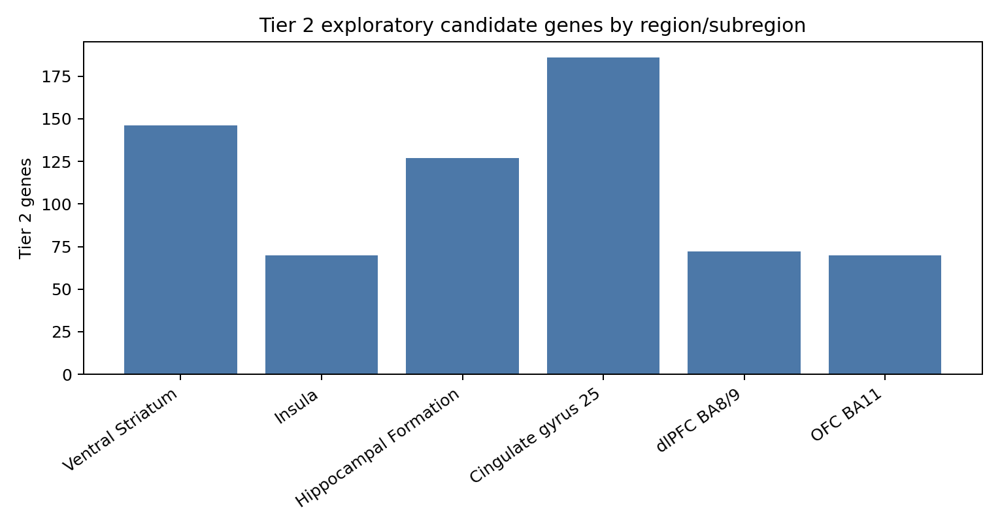

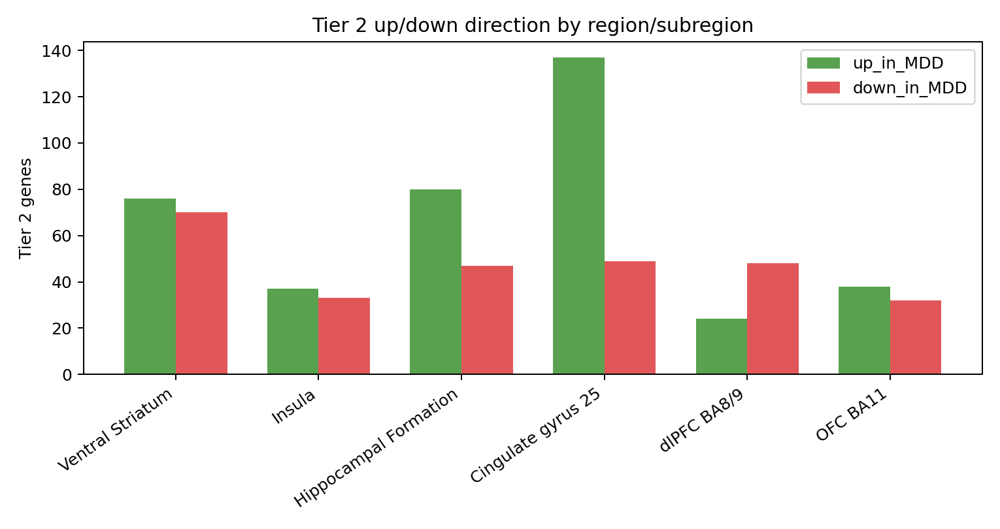

The broad Frontal Cortex had only one Tier 2 gene in the broad-region analysis, so frontal interpretation was moved to subregion sensitivity analyses: Cingulate gyrus 25, dlPFC BA8/9, and OFC BA11.

Two representative standardized-effect volcano plots are shown below.

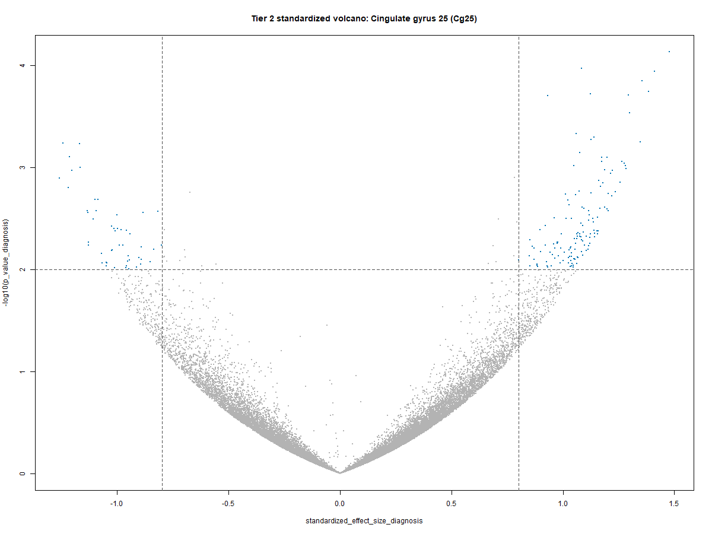

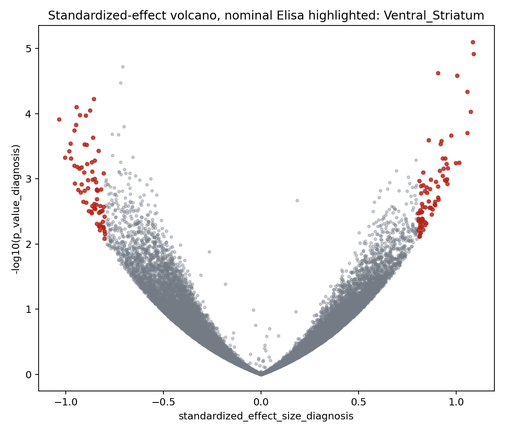

---

## 7. Enrichment analysis: biological interpretation

After defining Tier 2 genes, enrichment analysis asked:

> Are biological pathways, gene sets, or molecular functions overrepresented among the Tier 2 candidates?

The enrichment analyses used region/subregion-specific tested-gene backgrounds rather than all human genes. This is important because enrichment should be tested against the genes that could have been detected and tested in the analysis.

Enrichment is used here as a hypothesis generator, not as disease validation.

### Selected report-ready enrichment figures

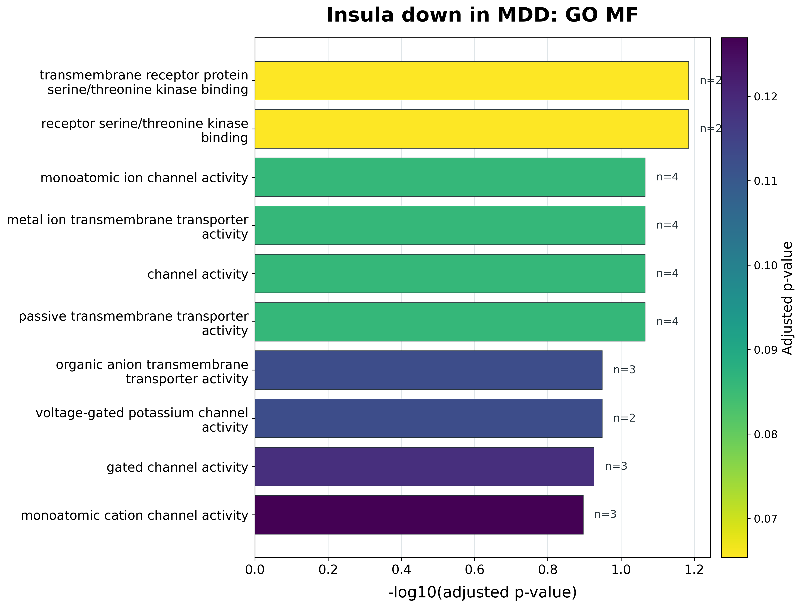

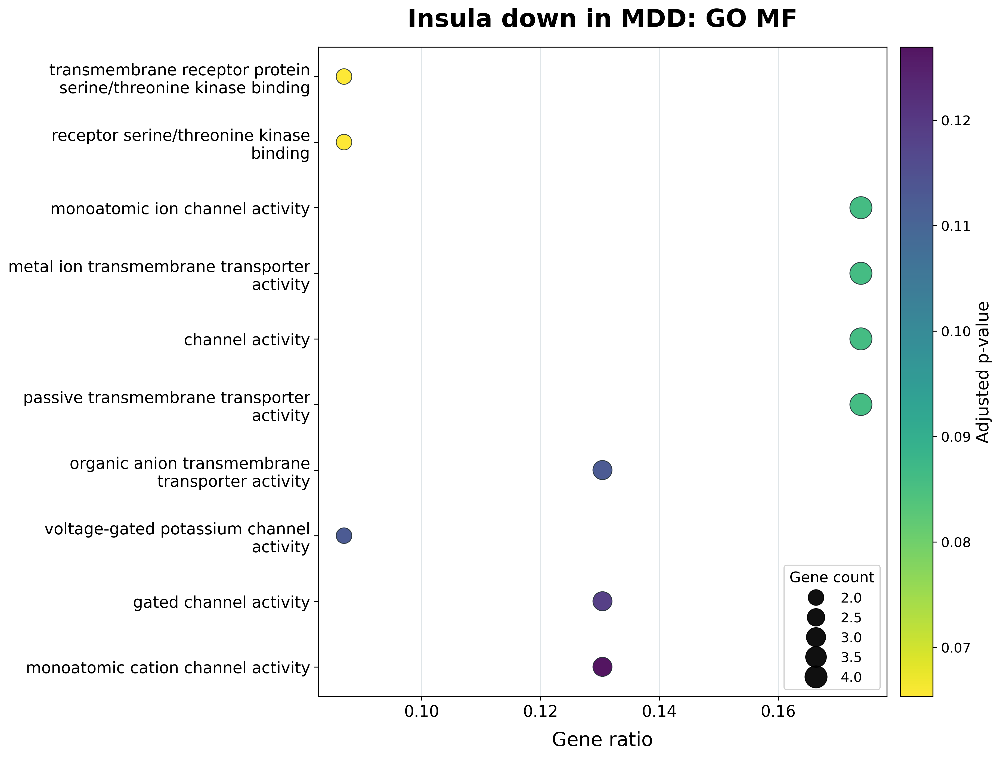

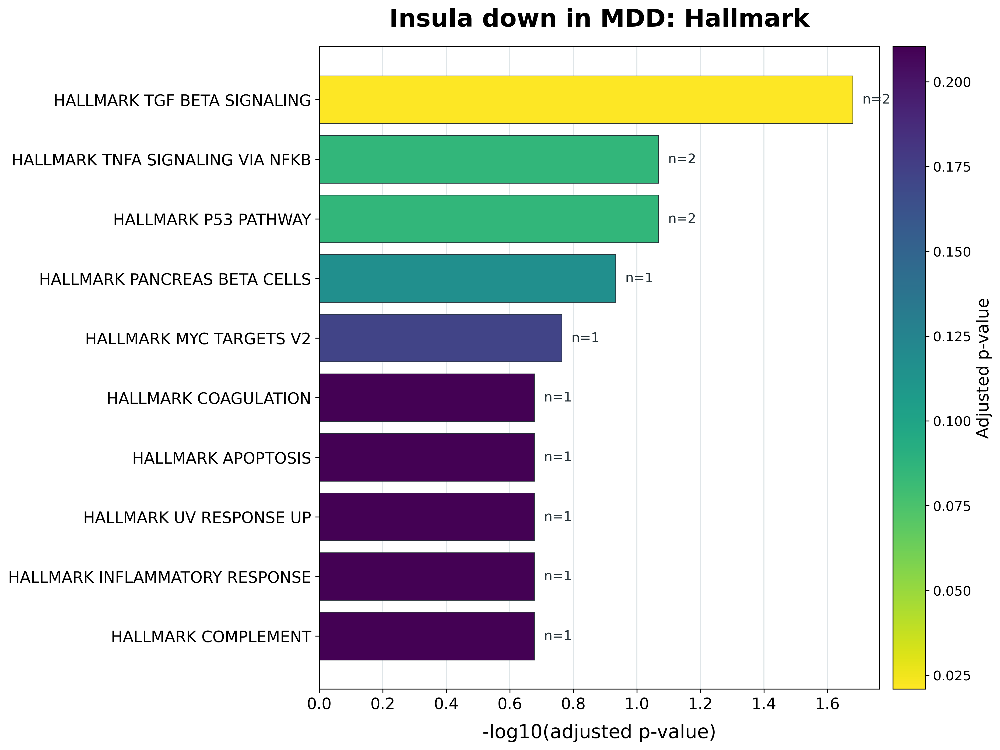

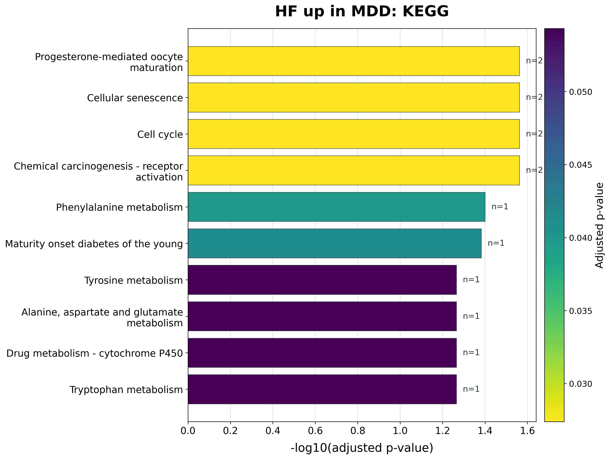

Interpretation should stay cautious: enrichment suggests biological themes for follow-up, not proof that these are validated disease pathways.

---

## 8. ML v1: exploratory gene prioritization, not validated prediction

The ML stage used normalized expression values to classify MDD versus Control within each brain region/subregion.

```text
Rows = samples
Columns = gene-expression features
Label = Diagnosis, MDD or Control
```

The ML stage was used to prioritize genes, not to claim a validated diagnostic classifier.

This distinction matters because Tier 2 and Tier 4 feature sets were defined using the full dataset before cross-validation. Therefore, fixed Tier 2 and Tier4_topK ML performance can be optimistic for prediction. The performance is useful descriptively, but the biological output is the prioritized gene list.

### Feature sets

| Feature set | Role |
| --- | --- |
| `Tier2_fixed` | Main exploratory Tier 2 candidate-gene feature set |
| `Tier4_top25` | Top 25 genes by absolute Tier 4 score |
| `Tier4_top50` | Top 50 genes by absolute Tier 4 score |
| `Tier4_top100` | Top 100 genes by absolute Tier 4 score |
| `Tier4_top250` | Top 250 genes by absolute Tier 4 score |
| `Tier4_top500` | Top 500 genes by absolute Tier 4 score |
| `strict_univariate_top100` | Fold-internal reference/sanity branch |

The strict univariate branch selected top genes inside each training fold using the ANOVA F statistic. It is a reference/sanity branch, not the source of the final ML-prioritized Tier 2 list.

### Models

The ML pilot used classical models only:

| Model | Role |
| --- | --- |
| Majority-class baseline | Baseline comparison |
| Logistic regression L2 | Stable linear classifier |
| Logistic regression L1 | Sparse linear classifier |
| Elastic-net logistic regression | Sparse plus stable linear classifier |
| Linear SVM | Linear high-dimensional classifier |
| Random Forest | Exploratory nonlinear model |

No deep learning was used.

### Cross-validation

The completed ML v1 run used:

```text
5 folds x 5 random seeds = 25 train/test evaluations per model configuration
```

Preprocessing was fit inside each training fold and then applied to the held-out fold. This prevents direct leakage through imputation or scaling. The remaining limitation is that Tier 2 and Tier 4 feature definitions were created before cross-validation.

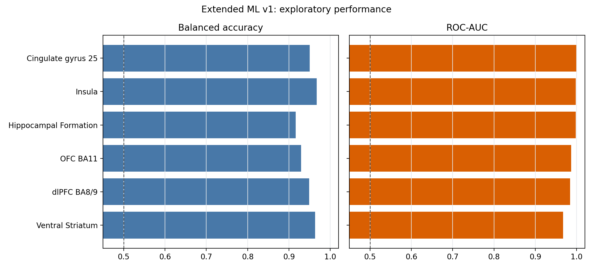

---

## 9. Stable ML-prioritized Tier 2 gene extraction

The final gene ranking asked:

> Among Tier 2 genes, which genes are repeatedly prioritized by ML models for MDD/control separation?

A strong candidate was not selected only because it had a small p-value. It received a higher ML-priority score when multiple signals supported it:

```text
1. It belonged to Tier 2.
2. It was repeatedly selected or assigned importance by ML.
3. It received support across model classes.
4. It received support across feature-set definitions.
5. Its ML coefficient direction was stable where direction was available.
6. Its ML direction agreed with the statistical diagnosis direction when assessable.
```

The current final ranked table contains:

| Output class                              |   Count |
|:------------------------------------------|--------:|
| All ranked Tier 2 gene-region pairs       |     671 |
| High-confidence ML-prioritized Tier 2     |      35 |
| Moderate-confidence ML-prioritized Tier 2 |     130 |

The high- and moderate-confidence counts by region are:

| Region/subregion      |   Ranked Tier 2 |   High-confidence |   Moderate-confidence |   High + moderate |   Lower-priority/exploratory |
|:----------------------|----------------:|------------------:|----------------------:|------------------:|-----------------------------:|
| Cingulate gyrus 25    |             186 |                 8 |                    29 |                37 |                          149 |
| Hippocampal Formation |             127 |                 3 |                    25 |                28 |                           99 |
| Insula                |              70 |                 6 |                    18 |                24 |                           46 |
| OFC BA11              |              70 |                 3 |                    28 |                31 |                           39 |
| Ventral Striatum      |             146 |                 8 |                    18 |                26 |                          120 |
| dlPFC BA8/9           |              72 |                 7 |                    12 |                19 |                           53 |

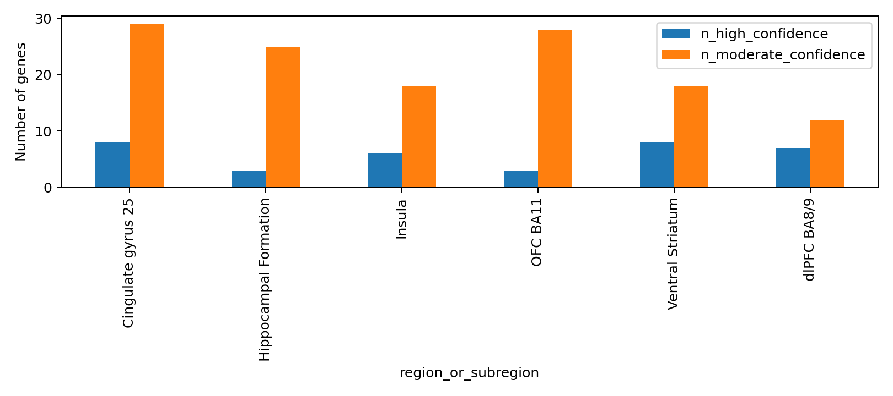

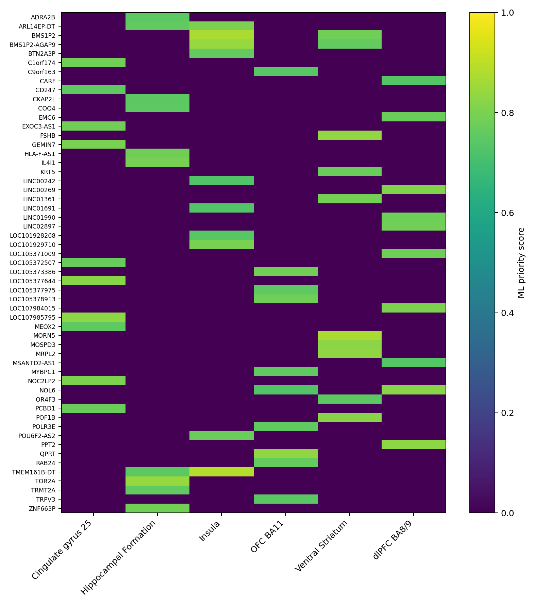

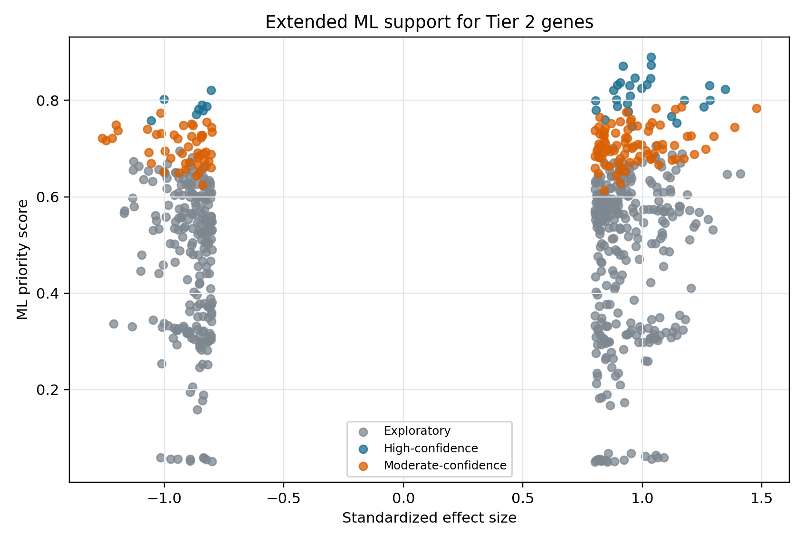

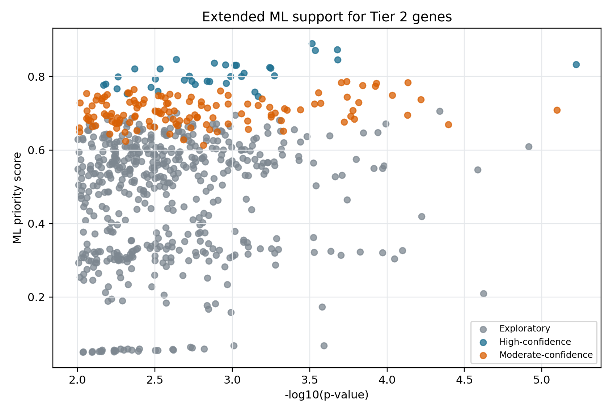

---

## 10. ML-priority score

The final ML-priority score is a composite score clipped between 0 and 1:

```text
ML_priority_score =
0.30 * selection_frequency_combined
+ 0.20 * model_support_scaled
+ 0.15 * sparse_model_support_binary
+ 0.15 * importance_rank_score
+ 0.10 * sign_consistency_score
+ 0.05 * statistical_model_evidence_scaled
+ 0.05 * v2_support_score
```

Most of the score comes from ML stability and repeated support. Statistical model evidence contributes only a small part because all ranked genes already had to belong to Tier 2.

| Score component | Meaning |
| --- | --- |
| `selection_frequency_combined` | How often the gene was selected or assigned importance across ML runs |
| `model_support_scaled` | How many model types supported the gene |
| `sparse_model_support_binary` | Whether sparse models such as L1 or elastic net supported the gene |
| `importance_rank_score` | Whether the gene ranked highly when it was important |
| `sign_consistency_score` | Whether signed linear models agreed on direction |
| `statistical_model_evidence_scaled` | Diagnosis evidence from the original statistical model |
| `v2_support_score` | Small auxiliary support from the stricter ML sanity branch |

The statistical evidence component was computed as:

```text
statistical_model_evidence_score = -log10(p_value_diagnosis) * abs(standardized_effect_size_diagnosis)
```

Then it was min-max scaled within region/subregion among the Tier 2 rows.

---

### 10a. High- and moderate-confidence thresholds

A gene-region pair was classified as high-confidence if it satisfied:

```text
ML_priority_score >= 0.70
selection_frequency_combined >= 0.50
model_support_count >= 2
sparse_model_support == True
sign_consistency >= 0.70
statistical/ML sign agreement is not explicitly false
```

A gene-region pair was classified as moderate-confidence if it was not already high-confidence and satisfied:

```text
ML_priority_score >= 0.45
selection_frequency_combined >= 0.25
model_support_count >= 1
statistical/ML sign agreement is not explicitly false
```

High- and moderate-confidence classes are mutually exclusive. High-confidence genes are not counted again as moderate-confidence genes.

A high-confidence gene means:

```text
The gene was already a Tier 2 MDD candidate,
and it was repeatedly supported by ML,
and it had stable or compatible direction/support.
```

A moderate-confidence gene means:

```text
The gene had meaningful ML support,
but weaker or less consistent support than the high-confidence group.
```

---

### 10b. Top high-confidence ML-prioritized genes

The top high-confidence gene-region pairs by ML-priority score were:

|   Rank | Gene         | Region/subregion      |   ML priority |   p-value |   Std effect | Direction   |   Model support |   Selection frequency |
|-------:|:-------------|:----------------------|--------------:|----------:|-------------:|:------------|----------------:|----------------------:|
|      1 | TMEM161B-DT  | Insula                |        0.8896 | 0.0003056 |       1.036  | up_in_MDD   |               5 |                0.7312 |
|      2 | BMS1P2       | Insula                |        0.8735 | 0.0002102 |       1.037  | up_in_MDD   |               5 |                0.7224 |
|      3 | MORN5        | Ventral Striatum      |        0.8714 | 0.0002906 |       0.9196 | up_in_MDD   |               5 |                0.7243 |
|      4 | TOR2A        | Hippocampal Formation |        0.8464 | 0.002306  |       0.9676 | up_in_MDD   |               5 |                0.6944 |
|      5 | BMS1P2-AGAP9 | Insula                |        0.846  | 0.0002088 |       1.034  | up_in_MDD   |               5 |                0.6336 |
|      6 | FSHB         | Ventral Striatum      |        0.8368 | 0.001312  |       0.9061 | up_in_MDD   |               5 |                0.7211 |
|      7 | QPRT         | OFC BA11              |        0.8325 | 5.997e-06 |       1.019  | up_in_MDD   |               5 |                0.5469 |
|      8 | MRPL2        | Ventral Striatum      |        0.8321 | 0.001106  |       0.8941 | up_in_MDD   |               5 |                0.6589 |
|      9 | PPT2         | dlPFC BA8/9           |        0.8314 | 0.0009407 |       0.9473 | up_in_MDD   |               5 |                0.6344 |
|     10 | LOC107985795 | Cingulate gyrus 25    |        0.8311 | 0.0009628 |       1.281  | up_in_MDD   |               5 |                0.6323 |
|     11 | MOSPD3       | Ventral Striatum      |        0.8247 | 0.0005745 |       0.9966 | up_in_MDD   |               5 |                0.6341 |
|     12 | LOC105377644 | Cingulate gyrus 25    |        0.8232 | 0.0005639 |       1.346  | up_in_MDD   |               5 |                0.6195 |
|     13 | NOL6         | dlPFC BA8/9           |        0.8208 | 0.004279  |      -0.8044 | down_in_MDD |               5 |                0.6315 |
|     14 | POF1B        | Ventral Striatum      |        0.8206 | 0.002932  |       0.8786 | up_in_MDD   |               5 |                0.6309 |
|     15 | LINC00269    | dlPFC BA8/9           |        0.8091 | 0.0008417 |       0.9482 | up_in_MDD   |               5 |                0.5507 |
|     16 | LOC107984015 | dlPFC BA8/9           |        0.8024 | 0.0005343 |      -1.001  | down_in_MDD |               5 |                0.6197 |
|     17 | ARL14EP-DT   | Insula                |        0.8018 | 0.001901  |       0.891  | up_in_MDD   |               5 |                0.5621 |
|     18 | NOC2LP2      | Cingulate gyrus 25    |        0.8008 | 0.0008725 |       1.175  | up_in_MDD   |               5 |                0.6072 |
|     19 | GEMIN7       | Cingulate gyrus 25    |        0.8    | 0.001029  |       1.282  | up_in_MDD   |               5 |                0.6043 |
|     20 | LOC101929710 | Insula                |        0.7996 | 0.00548   |       0.8043 | up_in_MDD   |               5 |                0.5792 |

Region-specific top-gene plots are below.

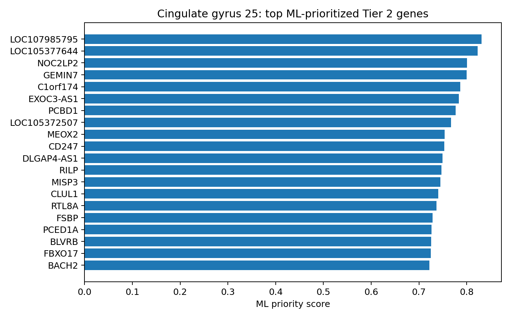

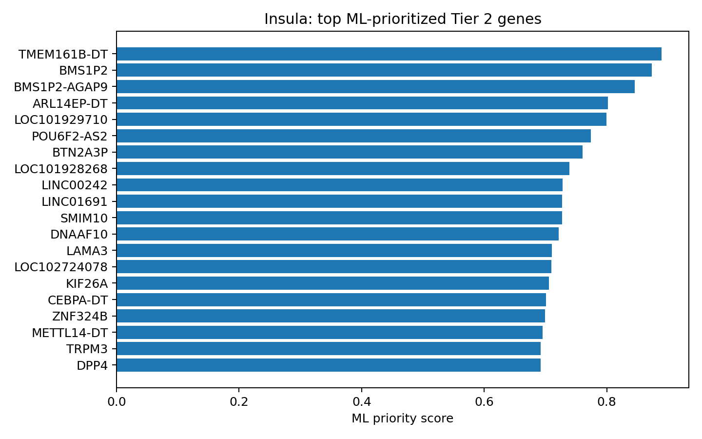

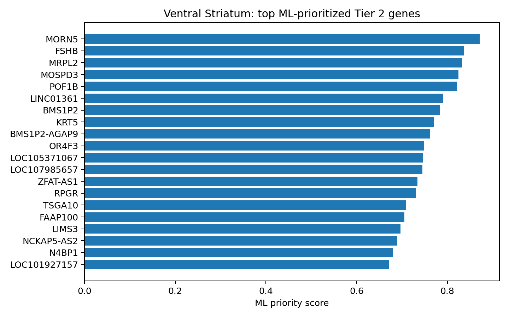

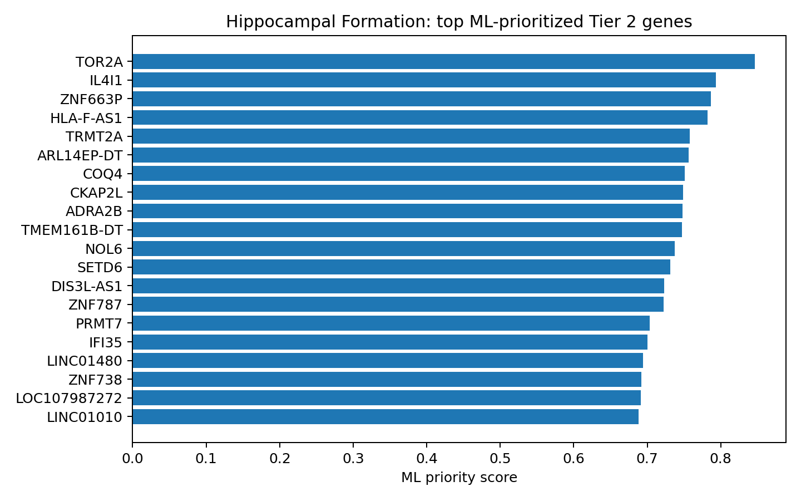

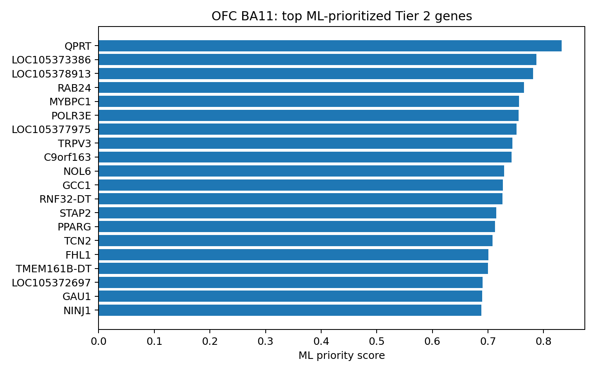

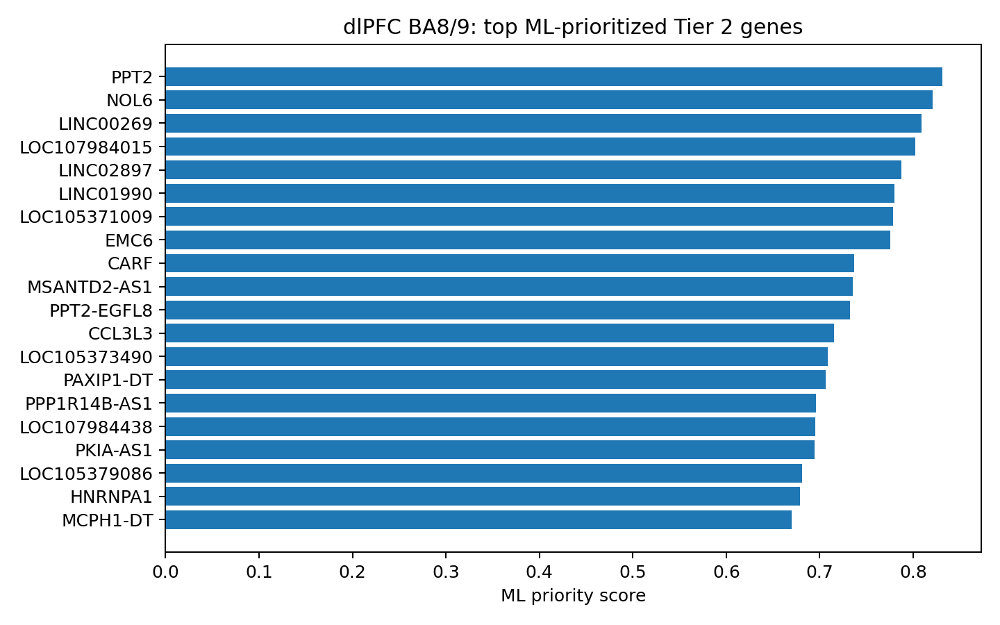

---

## 11. AHBA module enrichment stage

This biological-contextualization stage is Step 11 of the clean workflow:

```text
code/ahba_modules/
docs/ahba_modules/
outputs/length_gt_100_clean_pipeline/11_AHBA_modules_enrichment/
```

The goal is to use Allen Human Brain Atlas healthy-brain expression data to build or load coexpression modules, then test whether ML-prioritized MDD Tier 2 genes are enriched in those modules.

Important interpretation:

> AHBA module analysis provides healthy-brain coexpression context for ML-prioritized MDD candidate genes. It does not validate them as disease biomarkers.

---

## 12. MDD WGCNA module-analysis stage

The full MDD/control WGCNA module analysis is Step 12 of the clean workflow:

```text
code/Step6_MDD_WGCNA_modules.R
outputs/length_gt_100_clean_pipeline/12_MDD_WGCNA_modules/
docs/MDD_WGCNA_Module_Report.md
```

It builds modules from broad normalized GeTMM-log2 expression matrices with variance/MAD filtering. It does not build modules from DEG-only, Tier 2-only, or ML-only gene lists. The full report is:

```text
outputs/length_gt_100_clean_pipeline/12_MDD_WGCNA_modules/MDD_WGCNA_Module_Report_FULL.md
```

Important interpretation:

> MDD WGCNA modules are exploratory coexpression modules. Diagnosis associations, Tier 2/ML enrichment, and AHBA M26/M28/M2/M6/M7 overlaps are follow-up evidence, not externally validated disease biomarkers.

---

## 13. Current interpretation

The project now has a hierarchy of candidate evidence:

| Level | Meaning |
| --- | --- |
| Tier 1 | strict corrected standardized-effect anchors |
| Tier 2 | exploratory MDD-associated candidate genes |
| Tier 3 | previous raw-beta exploratory baseline |
| Tier 4 | ranked signatures for top-k and ranked follow-up analyses |
| ML-prioritized Tier 2 | Tier 2 genes repeatedly supported by ML |
| High-confidence ML-prioritized genes | strongest internally supported candidates |
| Moderate-confidence ML-prioritized genes | secondary internally supported candidates |

This is stronger than treating every Tier 2 gene equally because it combines:

```text
statistical diagnosis evidence
+ standardized effect size
+ ML model support
+ support across feature-set definitions
+ stability across folds/models
```

But it still does not prove validation. These are internally supported candidates for follow-up.

---

## 14. Main conclusion

The clean Length > 100 MDD analysis identified exploratory MDD-associated gene sets using standardized-effect evidence tiers. Tier 2 became the main candidate pool. Enrichment gave biological interpretation. ML was then used as a gene-prioritization tool, not as a validated diagnostic classifier.

The final clean result is:

```text
671 ranked Tier 2 gene-region pairs
35 high-confidence ML-prioritized Tier 2 gene-region pairs
130 moderate-confidence ML-prioritized Tier 2 gene-region pairs
```

These genes are the best current candidates for enrichment revisit, AHBA/WGCNA module mapping, pathway/module-level ML, and future external validation.

---

## 16. Recommended next steps

### 1. Enrichment revisit

Use high-confidence and high + moderate-confidence ML-prioritized Tier 2 genes. Ask whether the ML-prioritized genes fall inside the pathways found in the broader Tier 2 enrichment.

### 2. Ranked GSEA

Use Tier 4 ranked signatures. This avoids relying only on hard selected gene cutoffs.

### 3. AHBA/WGCNA module mapping

Test whether ML-prioritized Tier 2 genes map to healthy-brain coexpression modules.

### 4. Pathway/module-level ML

Instead of raw genes, use lower-dimensional biological features:

```text
pathway scores
module eigengenes
AHBA/WGCNA module scores
```

### 5. External validation search

Look for another MDD postmortem transcriptomics dataset or compatible validation resource.

---

## 17. Limitations

```text
Tier 2 genes are exploratory, not FDR-significant.
ML-prioritized genes are candidate genes, not validated biomarkers.
ML v1 performance is likely optimistic for prediction.
The analysis remains internal because there is no external validation set yet.
Sample sizes are limited within each region/subregion.
Postmortem transcriptomics has biological and technical noise.
AHBA is healthy-brain context, not MDD case-control validation.
```

All final wording should use terms such as exploratory, nominal, candidate signature, ranked signature, and internally supported candidate genes.
